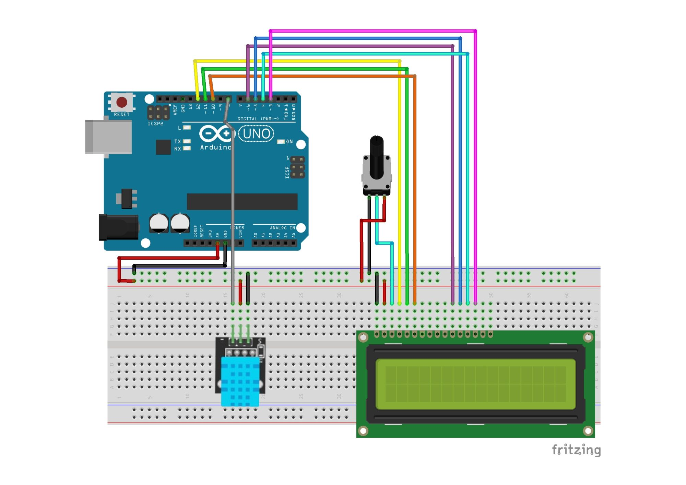

# DHT Sensor Arduino Project

## Overview

In this project, you will see how to build a simple weather station that will show the temperature on a lcd screen. You will need to an Arduino UNO, a lcd screen, a DHT sensor, a potentiometer, and a breadboard. The DHT sensor will send the temperature to the arduino for print it on the lcd screen.

## Components Used

- Arduino UNO
- Breadboard
- Lcd screen
- DHT sensor
- Potentiometer
- wires

## Wiring Diagram

See the image above for the complete wiring schematic.

## Installation

1. Assemble the circuit as shown in the wiring diagram.
2. Download this repository.
3. Install the Arduino IDE from [arduino.cc](https://www.arduino.cc/en/software).
4. Connect the Arduino UNO to your PC via USB.

## Usage

1. Upload the Arduino code to your board.
2. Power the circuit.
3. You will see that the lcd screen will show the temperature.

## Example Arduino Sketch

Check the code in the file: DHT_sensor/DHT_sensor.ino

## Dependencies

- Arduino IDE

## Credits

Wiring diagram created with Fritzing.
